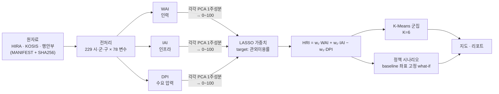

# HRI-korea — 시·군·구 의료 복원 지수

[](https://github.com/vashazza/HRI-korea/actions/workflows/ci.yml)
[](https://github.com/vashazza/HRI-korea/actions/workflows/pages.yml)

[](https://vashazza.github.io/HRI-korea/)

**[라이브 지도 →](https://vashazza.github.io/HRI-korea/)** 시·군·구에 마우스를 올리면 하위 지수·군집·관외이용률이 나온다. 가중치 슬라이더(프리셋: 등가중 / LASSO 점추정 / 부트스트랩 CI 하한·상한)를 움직이면 브라우저에서 HRI와 순위를 다시 계산해 지도를 다시 칠하고, 지역을 클릭하면 LASSO 가중치 대비 순위 변화가 나온다.

> **Summary.** HRI-korea builds a *Healthcare Restoration Index* for all 229 South Korean municipalities (si·gun·gu) from public HIRA and KOSIS statistics. Three PCA sub-indices — workforce (WAI), infrastructure (IAI) and demand pressure (DPI) — are combined with LASSO-derived weights, grouped into six regional types with K-Means, and probed with what-if policy scenarios. The whole chain, from a hashed raw-data manifest to the interactive map, re-runs with one command. It is a resource-distribution index, not a predictive model: across 200 random train/test splits it explains a median 28% of held-out variance in out-of-region care use, and it correlates only −0.07 with self-reported unmet medical need. Replacing province-level supply figures with municipality-level counts fixed a wrong-signed coefficient and showed that the workforce and infrastructure indices measure nearly the same thing (r = 0.91), so LASSO keeps only one of them. The Limitations section says what that means.

| **229** | **3** | **0.28** | **−0.07** |
|:---:|:---:|:---:|:---:|
| 시·군·구 | 하위 지수 (WAI·IAI·DPI) | holdout R² 중앙값 (관외이용률, 80:20 분할 200회) | HRI–미충족의료율 상관 (Pearson) |

**예측 모델이 아니라 자원 분포 지수다.** 관외이용률은 가중치 추정과 내부 검증에 모두 쓰여 순환성이 있다.

## 방법



1. **하위 지수** — 인구 10만 명당 인력(전문의·간호사·필수 5과), 인프라(의원~상급종합·보건소·수술실·CT·MRI), 수요(고령화·지방소멸·의료급여·1인당 진료비)를 각각 표준화한 뒤 PCA 첫 주성분으로 압축한다. 설명분산은 WAI 72.2%, IAI 44.0%, DPI 80.5%. 의사·전문의 수, CT·MRI 대수, 수술실·분만실 병상수는 요양기관 단위 신고 자료를 소재지 시·군·구로 집계한 실측치다.
2. **가중치** — 세 지수로 관외 의료이용률(거주 시·군·구 밖에서 쓴 진료비 비중)을 LASSO 회귀하고, 계수 절댓값 비율을 가중치로 쓴다. 결과 w = (0, 0.476, 0.524) — LASSO가 WAI 계수를 0으로 만들었다(아래 "공급측 자료 교체").
3. **군집** — WAI·IAI·DPI 공간에서 K-Means. 실루엣과 Ward 계층군집 일치도(ARI)를 합친 기준으로 K=6 (실루엣 0.380, ARI 0.829). 실루엣만 보면 K=3이 가장 높고(0.463), 경계가 뚜렷한 군집은 아니다.
4. **시나리오** — 하위 30% 지역에 자원을 더했을 때 HRI 변화. baseline에서 학습한 PCA·정규화 좌표를 고정하고 입력만 바꾼다.

## 실행

```bash
pip install -r requirements.txt && pip install -e . --no-deps
```

**원자료 없이 돌려보기 (권장).** 원자료는 라이선스·용량 문제로 레포에 없다. 대신 전처리 결과인 `data/processed/master_dataset.csv`가 커밋되어 있어, 그 이후 단계는 누구나 재실행할 수 있다.

```bash
make reproduce   # = hri reproduce : indices → model → cluster → simulate → figures → map
make test
```

같은 환경에서는 커밋된 `data/processed/*.csv`·`reports/hri_weights.json`과 바이트 단위로 같은 결과가 나온다. 수치 라이브러리(BLAS) 빌드가 다르면 마지막 자리 부동소수점만 달라지므로, CI는 새 환경에서 재실행한 결과를 `scripts/check_reproduced.py`로 커밋본과 허용오차 1e-9로 비교한다. (`docs/index.html`은 Folium이 빌드마다 요소 ID를 새로 붙여서 그 부분만 달라진다.)

**원자료부터 전부.** 원자료 목록·출처·기준시점·SHA256은 [`data/raw/MANIFEST.yaml`](data/raw/MANIFEST.yaml)에 있다.

```bash
make check_data  # = hri check-data : 존재·해시 검사, 누락 파일은 받는 곳 안내
make full        # = hri run-all    : check-data → preprocess → reproduce
```

단계별로는 `hri <check-data|preprocess|indices|model|cluster|simulate|figures|map>`.

## 결과

**지역 유형 (K=6)** — HRI 평균 순

| 유형 | 시·군·구 | WAI | IAI | DPI | HRI | 예 |
|---|---:|---:|---:|---:|---:|---|
| 대형병원 밀집 도심형 | 5 | 71.1 | 80.5 | 32.1 | 82.4 | 서울 종로·강남, 대구 중구, 부산 서구, 광주 동구 |
| 대도시 거점형 | 60 | 20.6 | 23.6 | 26.0 | 55.3 | 수원, 고양, 창원, 성남, 전주 |
| 신도시·외곽 저수요형 | 47 | 10.0 | 12.2 | 16.6 | 54.7 | 용인, 화성, 남양주, 평택, 김해 |
| 병원 밀집 지역형 | 6 | 39.9 | 46.8 | 50.8 | 53.0 | 서울 서초·중구, 대구 남구, 부산 동·중구, 전남 화순 |
| 중소도시·구도심 중간형 | 57 | 10.4 | 14.6 | 49.2 | 36.6 | 여수, 군산, 경주, 부산 사하, 서울 강북 |
| 고령지역 자원부족형 | 54 | 6.8 | 9.3 | 80.3 | 15.2 | 의성, 고흥, 해남, 부여, 김제 |

WAI와 IAI는 대형병원이 있는 몇 곳에 몰려 있다(중앙값 11.3과 15.5, 최댓값 100). 신도시·외곽 저수요형은 자원이 적은데도 HRI가 높다 — 젊어서 수요 압력(DPI)이 가장 낮기 때문이다.

**시나리오 — 군집 평균 ΔHRI** (LASSO 가중치 기준)

| 시나리오 | 대상 | 고령·자원부족 | 중소도시·구도심 | 신도시·외곽 | 대도시 거점 | 병원 밀집 지역 | 대형병원 도심 |
|---|---:|---:|---:|---:|---:|---:|---:|
| S1 필수 5과 전문의 +10% (WAI 하위 30%) | 69곳 | 0 | 0 | 0 | 0 | 0 | 0 |
| S2 의원 +5개 (IAI 하위 30%) | 69곳 | +0.31 | +0.10 | +0.05 | 0.00 | 0 | 0 |
| S3 CT·MRI 각 +1대 (보유 하위 30%) | 69곳 | +1.57 | +0.34 | +0.32 | +0.01 | 0 | 0 |
| S4 보건의료원 없는 곳에 신설 | 213곳 | −0.66 | −0.38 | −0.18 | −0.10 | −0.39 | −0.25 |

- S1이 전부 0인 것은 계산 오류가 아니라 WAI 가중치가 0이기 때문이다. 이 지수는 인력 투입을 따로 평가하지 못한다.
- S4가 음수인 것은 보건의료원의 IAI 적재값이 음수(−0.11)여서다. 보건의료원은 병원이 적은 농촌에 주로 있어 "인프라가 많은 지역" 축과 반대 방향으로 잡힌다. 보건의료원 신설이 해롭다는 뜻이 아니라, 이 지수로는 평가할 수 없다는 뜻이다.

## 공급측 자료 교체 — 진단, 교체, 그리고 드러난 것

처음에는 HIRA의 인력·장비·병상 통계가 시·도 단위라 시·군·구 인구 비례로 나눠 썼다. 그러면 같은 시·도 안에서는 인구당 값이 똑같아진다. 회귀에서 WAI 계수가 "인력이 많을수록 관외이용이 많다"는 반대 방향으로 나왔고, 원인을 자료 해상도로 진단했다. HIRA가 공개하는 요양기관 단위 신고 자료(2024년 12월, 78,482곳)에 기관별 소재지·의사 수·과목별 전문의 수·장비 대수·병상수가 있어, 이를 시·군·구로 직접 집계해 두 차례에 걸쳐 교체했다.

| | ① 전부 시·도 값 분배 | ② 의사·전문의 실측 | ③ + CT·MRI·수술실·분만실 실측 (현재) |
|---|---:|---:|---:|
| WAI 계수 (관외이용률에 대해) | +0.0020 | −0.0017 | 0 |
| IAI 계수 | −0.0036 | 0 | −0.0016 |
| LASSO 가중치 (WAI, IAI, DPI) | 0.241, 0.431, 0.328 | 0.454, 0, 0.546 | 0, 0.476, 0.524 |
| WAI–IAI 상관 | 0.87 | 0.66 | 0.91 |
| holdout R² 중앙값 (분할 200회) | 0.24 | 0.21 | 0.28 |
| HRI–미충족의료율 상관 | −0.13 | −0.06 | −0.07 |

- **부호 진단은 맞았다.** ②에서 WAI를 실측으로 바꾸자 계수가 음수로 돌아섰다. ③에서도 WAI 단독으로는 관외이용률과 음의 관계다(상관 −0.33).
- **인력과 인프라는 거의 같은 것을 잰다.** 둘 다 실측이 되자 상관이 0.91이다. 병원이 있는 곳에 의사도 장비도 있다. LASSO는 둘 중 하나만 남기는데, ②에서는 WAI가, ③에서는 IAI가 남았다 — 더 정확하게 측정된 쪽이 남은 셈이다. ③의 부트스트랩 100회에서 IAI는 매번, WAI는 58%만 남는다(`reports/hri_weights.json`의 `selected`).
- **그래서 "인력과 인프라 중 무엇이 더 중요한가"는 이 자료로 답할 수 없다.** ②만 보고 "인프라는 인력과 중복이라 기여가 없다"고 결론 냈다면 틀렸을 것이다. 가중치는 두 지수의 상대적 중요도가 아니라 "공급 전체"와 "수요"의 비중으로 읽어야 한다.
- **설명력은 ③에서 조금 올랐다**(holdout 중앙값 0.28). 외부 지표(미충족의료율)와는 여전히 거의 무상관이다.
- **분할 한 번짜리 holdout은 믿을 수 없다.** WAI·IAI가 몇 곳에 몰려 있어서, 그 지역이 검증셋에 들어가느냐에 따라 값이 크게 흔들린다(seed 42 분할: ① 0.15, ② −0.36, ③ 0.11). 그래서 분할을 200번 바꾼 분포를 보고한다(③: 중앙값 0.28, 사분위 0.17~0.34, 8%는 음수).

함께 고친 버그: 간호사 로더가 합계 행 이름을 잘못 걸러 간호사 관련 22개 열이 전부 0이었다. 위 표의 ① 열은 이 수정을 반영한 값이다. 간호사는 시·군·구 자료를 찾지 못해 지금도 시·도 값 분배다.

자세한 경과(시행착오 포함)는 [`reports/comprehensive_report.md`](reports/comprehensive_report.md), 검증 수치는 [`reports/hri_validation.md`](reports/hri_validation.md).

## Limitations

1. **WAI와 IAI가 분리되지 않는다.** 상관 0.91이라 LASSO가 WAI 가중치를 0으로 두었고, HRI는 사실상 0.48·IAI − 0.52·DPI다. 셋을 함께 OLS에 넣으면 WAI 계수는 다시 양수로 뒤집힌다(다중공선성). 두 지수를 하나의 공급 지수로 합치는 것이 더 정직한 구조일 수 있지만 하지 않았다.
2. **가중치가 불안정하다.** 부트스트랩 95% 구간이 w₁ 0~0.38, w₂ 0.41~0.69, w₃ 0.11~0.58이다. 순위는 가중치에 따라 달라지며, 지도의 슬라이더로 직접 볼 수 있다.
3. **WAI·IAI가 극단값에 끌린다.** 인구당 전문의·장비는 대형병원 소재지에 몰려 있어(왜도 3.45, 3.02) 0~100 눈금의 대부분을 몇 곳이 차지한다. 로그 변환 같은 처리는 하지 않았다.
4. **보건소·보건의료원은 IAI에 음의 방향으로 들어간다.** 그래서 S4는 HRI를 낮춘다. IAI의 PC1 설명분산은 44%로, 한 축에 다 담기지 않는다.
5. **간호사는 여전히 시·도 값이다.** 시·군·구 인구 비례로 나눴으므로 같은 시·도 안에서는 인구당 값이 같다.
6. **연도가 맞지 않는다.** 의사·전문의·장비·병상은 2024년 12월, 간호사와 기관 수는 2026년 1분기, 수요·결과측(인구·미충족의료·관외이용·의료급여)은 2024년 기준이다 ([MANIFEST](data/raw/MANIFEST.yaml) `reference_period`).
7. **검증에 순환성이 있다.** 관외이용률로 가중치를 추정하고 같은 변수로 내부 검증을 했다. 이 변수와 독립인 외부 지표는 미충족의료율 하나이고 상관은 −0.07이다.
8. **치료가능사망률로 외부 검증하지 못했다.** 사망원인통계가 시·도 단위만 공개돼 시·군·구 비교가 불가능했다.
9. **미충족의료율은 잡음이 크다.** 지역사회건강조사 응답자가 시·군·구당 중앙값 848명이다. 이 변수를 종속변수로 쓰면 LASSO가 세 계수를 모두 0으로 만든다(R² 0).
10. **공급 자료는 소재지 기준이다.** 종로구의 전문의와 MRI는 종로구 주민만 쓰지 않는다. 공간 자기상관이나 이웃 지역 이용을 모형이 모른다.
11. **시나리오는 인과 추정이 아니다.** 지수 정의 안에서 입력을 바꿨을 때의 상관 기반 what-if다.
12. **2024년 횡단면 하나다.** 시간에 따른 변화나 정책 전후 비교는 없다.

**의도적으로 다루지 않은 것** — 공간시차·공간오차 모형과 GWR, DiD 기반 시나리오 보정, 가중치 방법 비교(PCA·AHP)와 Monte Carlo 순위 강건성 검토, 학술지 투고.

## 구조

```
data/
  raw/MANIFEST.yaml  # 원자료 23개의 출처·기준시점·SHA256 (원자료 자체는 gitignore)
  processed/         # master_dataset.csv 이하 모든 산출 CSV (커밋됨)
src/hri/
  paths.py           # 경로 중앙화 (MANIFEST와 1:1)
  check_data.py      # 원자료 검사
  loader.py          # 원자료 로드, 시·도/시·군·구 표기 정규화
  preprocess.py      # master_dataset 빌드
  indices.py         # WAI/IAI/DPI PCA (fit/transform 분리)
  hri.py             # LASSO 가중치, HRI, 검증
  clustering.py      # K-Means + Ward 교차 검증
  simulation.py      # baseline 좌표 고정 시나리오
  cli.py             # hri 명령
scripts/             # 정적 그림, 지도 빌드, 진단 스크립트
reports/             # 검증·군집·시나리오 리포트, figures/
docs/                # GitHub Pages (index.html)
tests/
```

지도는 2013년 기준 시·군·구 경계(southkorea-maps)를 쓰고, 이후 행정구역 변동(군위군 → 대구, 청원군 → 청주, 인천 남구 → 미추홀구)은 매핑으로 맞췄다. `make map`이 GeoJSON이 없으면 내려받는다.
