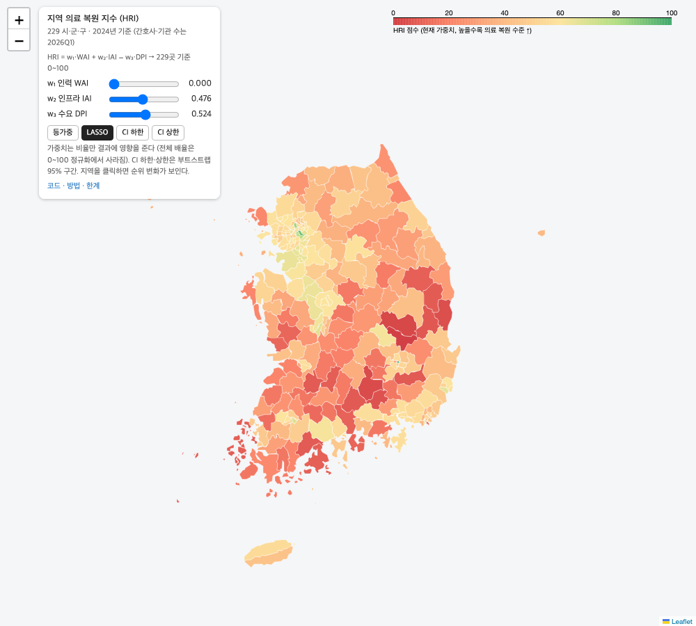
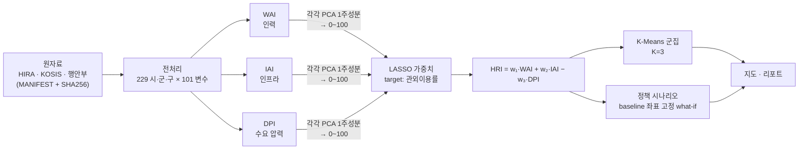

# HRI-korea — 시·군·구 의료 복원 지수

[](https://github.com/vashazza/HRI-korea/actions/workflows/ci.yml)
[](https://github.com/vashazza/HRI-korea/actions/workflows/pages.yml)

[](https://vashazza.github.io/HRI-korea/)

**[라이브 지도 →](https://vashazza.github.io/HRI-korea/)** 시·군·구에 마우스를 올리면 하위 지수·군집·관외이용률이 나온다.

> **Summary.** HRI-korea builds a *Healthcare Restoration Index* for all 229 South Korean municipalities (si·gun·gu) from public HIRA and KOSIS statistics. Three PCA sub-indices — workforce (WAI), infrastructure (IAI) and demand pressure (DPI) — are combined with LASSO-derived weights, grouped into three regional types with K-Means, and probed with what-if policy scenarios. The whole chain, from a hashed raw-data manifest to the interactive map, re-runs with one command. It is a resource-distribution index, not a predictive model: it explains 13% of held-out variance in out-of-region care use and correlates only −0.13 with self-reported unmet medical need. The Limitations section says why.

| **229** | **3** | **0.13** | **−0.13** |
|:---:|:---:|:---:|:---:|
| 시·군·구 | 하위 지수 (WAI·IAI·DPI) | holdout R² (관외이용률) | HRI–미충족의료율 상관 (Pearson) |

**예측 모델이 아니라 자원 분포 지수다.** 관외이용률은 가중치 추정과 내부 검증에 모두 쓰여 순환성이 있다.

## 방법



1. **하위 지수** — 인구 10만 명당 인력(전문의·간호사·필수 5과), 인프라(의원~상급종합·보건소·수술실·CT·MRI), 수요(고령화·지방소멸·의료급여·1인당 진료비)를 각각 표준화한 뒤 PCA 첫 주성분으로 압축한다. 설명분산은 WAI 78.5%, IAI 33.3%, DPI 80.5%.
2. **가중치** — 세 지수로 관외 의료이용률(거주 시·군·구 밖에서 쓴 진료비 비중)을 LASSO 회귀하고, 계수 절댓값 비율을 가중치로 쓴다. 결과 w = (0.236, 0.407, 0.357).
3. **군집** — WAI·IAI·DPI 공간에서 K-Means. K=3에서 실루엣 0.474, Ward 계층군집과의 ARI 0.651.
4. **시나리오** — 하위 30% 지역에 자원을 더했을 때 HRI 변화. baseline에서 학습한 PCA·정규화 좌표를 고정하고 입력만 바꾼다.

## 실행

```bash
pip install -r requirements.txt && pip install -e . --no-deps
```

**원자료 없이 돌려보기 (권장).** 원자료는 라이선스·용량 문제로 레포에 없다. 대신 전처리 결과인 `data/processed/master_dataset.csv`가 커밋되어 있어, 그 이후 단계는 누구나 재실행할 수 있다.

```bash
make reproduce   # = hri reproduce : indices → model → cluster → simulate → figures → map
make test
```

같은 환경에서는 커밋된 `data/processed/*.csv`·`reports/hri_weights.json`과 바이트 단위로 같은 결과가 나온다. 수치 라이브러리(BLAS) 빌드가 다르면 마지막 자리 부동소수점만 달라지므로, CI는 새 환경에서 재실행한 결과를 `scripts/check_reproduced.py`로 커밋본과 허용오차 1e-9로 비교한다. (`docs/index.html`은 Folium이 빌드마다 요소 ID를 새로 붙여서 그 부분만 달라진다.)

**원자료부터 전부.** 원자료 목록·출처·기준시점·SHA256은 [`data/raw/MANIFEST.yaml`](data/raw/MANIFEST.yaml)에 있다.

```bash
make check_data  # = hri check-data : 존재·해시 검사, 누락 파일은 받는 곳 안내
make full        # = hri run-all    : check-data → preprocess → reproduce
```

단계별로는 `hri <check-data|preprocess|indices|model|cluster|simulate|figures|map>`.

## 결과

**지역 유형 (K=3)**

| 유형 | 시·군·구 | WAI | IAI | DPI | HRI | 예 |
|---|---:|---:|---:|---:|---:|---|
| 수도권·거점-자원풍부형 | 58 | 80.8 | 65.2 | 31.1 | 72.9 | 서울 강남·서초, 대구 중구 |
| 중간도시-기본형 | 91 | 17.9 | 28.2 | 25.3 | 41.0 | 전주, 화성, 인천 연수 |
| 농촌·고령-취약형 | 80 | 14.7 | 30.5 | 72.9 | 21.7 | 경북 의성·영덕·청송 |

**시나리오 — 군집 평균 ΔHRI**

| 시나리오 (대상: 해당 지표 하위 30%) | 농촌·고령 | 중간도시 | 수도권·거점 |
|---|---:|---:|---:|
| S1 필수 5과 전문의 +10% | +0.96 | +0.60 | 0.00 |
| S2 의원 +5개 | +0.18 | +0.07 | 0.00 |
| S3 CT·MRI 각 +1대 | +2.92 | +1.02 | 0.00 |
| S4 보건의료원 없는 곳에 신설 | −0.80 | −0.26 | −0.19 |

수도권·거점형이 S1~S3에서 0인 것은 하위 30%에 해당하는 곳이 없어서다. S4가 음수인 이유는 아래 Limitations 6번.

자세한 경과(시행착오 포함)는 [`reports/comprehensive_report.md`](reports/comprehensive_report.md), 검증 수치는 [`reports/hri_validation.md`](reports/hri_validation.md).

## Limitations

1. **WAI가 시·도 평균에 묶여 있고, 그래서 계수 부호가 뒤집힌다.** 사용한 HIRA 인력·전문의·장비 자료가 시·도 단위라 시·군·구 인구 비례로 나눴다. 같은 시·도 안의 시·군·구는 인구당 값이 똑같아지므로 WAI는 사실상 17개 값뿐이다. LASSO에서 WAI 계수는 +0.0018로 "인력이 많을수록 관외이용이 많다"는 직관과 반대 방향이 나왔고, HRI 식에서는 정의대로 +w₁로 두었다.
2. **연도가 맞지 않는다.** 공급측 HIRA 자료는 2026년 1분기, 수요·결과측(인구·미충족의료·관외이용·의료급여)은 2024년 기준이다 ([MANIFEST](data/raw/MANIFEST.yaml) `reference_period`).
3. **검증에 순환성이 있다.** 관외이용률로 가중치를 추정하고 같은 변수로 내부 검증을 했다. 이 변수와 독립인 외부 지표는 미충족의료율 하나이고 상관은 −0.13이다.
4. **치료가능사망률로 외부 검증하지 못했다.** 사망원인통계가 시·도 단위만 공개돼 시·군·구 비교가 불가능했다.
5. **미충족의료율은 잡음이 크다.** 지역사회건강조사 응답자가 시·군·구당 중앙값 848명이다. 이 변수를 종속변수로 쓰면 R²가 0.015였다.
6. **IAI는 한 축으로 잘 묶이지 않는다.** PC1 설명분산이 33%이고, 보건의료원 적재값이 −0.10으로 음수다(보건의료원이 병원 적은 농촌에 주로 있어서). 그래서 보건의료원을 늘리는 S4는 HRI를 낮추고, 이 지수로는 보건의료원 정책을 평가할 수 없다.
7. **공간 자기상관을 반영하지 않았다.** 이웃 시·군·구의 큰 병원으로 가는 효과를 모형이 모른다.
8. **시나리오는 인과 추정이 아니다.** 지수 정의 안에서 입력을 바꿨을 때의 상관 기반 what-if다.
9. **2024년 횡단면 하나다.** 시간에 따른 변화나 정책 전후 비교는 없다.

**의도적으로 다루지 않은 것** — 공간시차·공간오차 모형과 GWR, DiD 기반 시나리오 보정, 가중치 방법 비교(PCA·AHP)와 Monte Carlo 순위 강건성 검토, 학술지 투고.

## 구조

```
data/
  raw/MANIFEST.yaml  # 원자료 목록·출처·SHA256 (원자료 자체는 gitignore)
  processed/         # master_dataset.csv 이하 모든 산출 CSV (커밋됨)
src/hri/
  paths.py           # 경로 중앙화 (MANIFEST와 1:1)
  check_data.py      # 원자료 검사
  loader.py          # 원자료 로드, 시·도/시·군·구 표기 정규화
  preprocess.py      # master_dataset 빌드
  indices.py         # WAI/IAI/DPI PCA (fit/transform 분리)
  hri.py             # LASSO 가중치, HRI, 검증
  clustering.py      # K-Means + Ward 교차 검증
  simulation.py      # baseline 좌표 고정 시나리오
  cli.py             # hri 명령
scripts/             # 정적 그림, 지도 빌드, 진단 스크립트
reports/             # 검증·군집·시나리오 리포트, figures/
docs/                # GitHub Pages (index.html)
tests/
```

지도는 2013년 기준 시·군·구 경계(southkorea-maps)를 쓰고, 이후 행정구역 변동(군위군 → 대구, 청원군 → 청주, 인천 남구 → 미추홀구)은 매핑으로 맞췄다. `make map`이 GeoJSON이 없으면 내려받는다.
